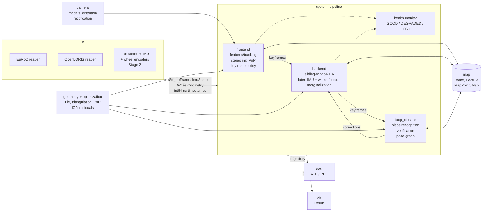

SLAMBot Roadmap
---------------

Living plan for learning SLAM by building a stereo(-inertial) SLAM system.
It refines the master plan in issue #5. **This file is the plan; GitHub issues
and milestones track the execution.** Last updated 2026-10-31.

**Foundation:** Gao & Zhang, *Introduction to Visual SLAM: From Theory to
Practice* (2nd ed., a.k.a. *14 Lectures on Visual SLAM*).
- English text (LaTeX): https://github.com/gaoxiang12/slambook-en
- Companion code: https://github.com/gaoxiang12/slambook2 (folders `ch2`–`ch13`
  match the chapter numbers used below)

**Aim:** learn visual SLAM while building a robot that localizes robustly.

**Stages (from #5):** 1) run on a dataset, 2) run on our own hardware
(stereo camera with IMU, wheel encoders, small computer; see
[D8](#d8-sensor-suite)).

## Contents
1. [Guiding principles](#1-guiding-principles)
2. [Fix first](#2-fix-first)
3. [Decisions to make](#3-decisions-to-make)
4. [Target architecture](#4-target-architecture)
5. [Phases](#5-phases)
6. [Datasets](#6-datasets)
7. [Testing strategy](#7-testing-strategy)
8. [CI/CD](#8-cicd)
9. [Dev environment and tooling](#9-dev-environment-and-tooling)
10. [Learning workflow with Claude Code](#10-learning-workflow-with-claude-code)
11. [Tracking on GitHub](#11-tracking-on-github)
12. [Reading beyond the book](#12-reading-beyond-the-book)
13. [Appendix: porting book code](#13-appendix-porting-book-code)

---

## 1. Guiding principles

- **Learn by building.** Every phase is read → experiment → build a module →
  test it → measure the system.
- **End-to-end early.** A first stereo VO runs on EuRoC by Phase 5. Every later
  phase must move a number (ATE/RPE, robustness, speed), so progress is visible.
- **The book's code is a reference, not a template.** Chapter 13's design is
  our starting point, but it has known weaknesses (see
  [§4.2](#42-what-we-change-from-the-books-chapter-13-design)). It also
  targets KITTI (pre-rectified, no IMU), while we target EuRoC (raw stereo +
  IMU).
- **Robust, not just accurate.** The robot must keep a pose estimate when
  vision fails. So we also measure tracking loss and recovery, not only
  trajectory error.
- **If it isn't tested, it doesn't work.** Geometry and optimization code is
  verified with synthetic data that has known ground truth, and numerical
  Jacobians. The full pipeline is verified with trajectory error in CI.
- **We own the math.** The core algorithms are written by us. Claude does
  scaffolding, infrastructure, tests and review (see [§10](#10-learning-workflow-with-claude-code)).

Legend used below: 🧠 we implement it (learning core) · 🤝 pair with Claude ·
🤖 Claude implements it, we review.

---

## 2. Fix first

These keep the current layout from working reliably. They are all Phase 0.
All are done: most in PR #6, F11 and the rest of F9 in the module-layout PR.

| # | Problem | Fix |
|---|---|---|
| F1 | `extern/Pangolin` submodule is not initialized in existing clones, so `add_subdirectory(Pangolin)` fails. | `git submodule update --init --recursive` in the README. Pangolin itself goes away in the Phase 0 restructure ([D2](#d2-visualization) = Rerun). |
| F2 | [CMakeLists.txt](../CMakeLists.txt) includes the Conan toolchain *after* `project()` and *after* `add_subdirectory(extern)`. So Pangolin is configured without Conan and uses the system Eigen (the reason `libeigen3-dev` is in the Dockerfile). Conan's compiler settings are ignored. The `${CMAKE_BINARY_DIR}/../conan` path only works for `build/<x>` folders. | Delete the `include()`. Configure through the Conan-generated preset (`cmake --preset conan-release`) or `-DCMAKE_TOOLCHAIN_FILE=…`, wrapped in a committed `CMakePresets.json`. |
| F3 | `conan install` in the README has no `--build=missing`, so it fails whenever ConanCenter has no prebuilt binary for our profile. | Add `--build=missing` and cache `~/.conan2` (OpenCV from source is slow). |
| F4 | The Dockerfile installs `g++12`, which is not a valid package name (`g++-12`), while the Conan profile says gcc 11. CI used `conan profile detect` instead of the committed profile. | Pick one compiler ([D3](#d3-c-standard-compiler-and-base-image)), and use the committed profile everywhere (local, Docker, CI). |
| F5 | The README docker commands use `$pwd`, which is empty in bash and zsh, so the bind mount and `-w` break. | `$PWD`. |
| F6 | The README says to run `./SLAMBot/SLAMBot`, but the target is `SLAMBotApp`. | Fix the docs (or rename the target in the new layout). |
| F7 | `SLAMBot/FeatureExtraction.cpp` is not in any target. It uses `CV_LOAD_IMAGE_COLOR` (removed in OpenCV 4) and is missing `<cassert>`, `<string>` and `<vector>`. | Move it to `experiments/ch07_orb/` and port it to OpenCV 4 ([§13](#13-appendix-porting-book-code)). |
| F8 | `test_opencv` and `test_pangolin` are GUI demos built into the main build. They need a display and are named like tests. | Move them to `experiments/`; never run them in CI. |
| F9 | The `SLAMBot` library calls `find_package()` for four packages and links none. Its include root is the repo root, which exposes `extern/`, `build/`, etc. | Call `find_package` where it's used. Each module target links what it uses. Includes start at `slambot/`, e.g. `#include "slambot/core/timestamp.hpp"`, as in Abseil (see [§4.3](#43-repository-layout)). |
| F10 | Branch `2-Add-CI` is stale: old build layout, no `submodules:` checkout, and `docker/login-action` without `registry: ghcr.io` (it logs in to Docker Hub, then pushes to GHCR). | Replace it with the CI in [§8](#8-cicd). |
| F11 | Style split: `main` uses `namespace slam` and trailing return types. `frontend/dataset-frames` uses `namespace SLAMBot`, `m_` members, and `#pragma once` after includes. | [D5](#d5-naming-and-style) decided (snake_case). Rename and enforce it with clang-tidy in the Phase 0 restructure. |
| F12 | No Conan lockfile, so builds aren't reproducible. | `conan lock create .` and commit `conan.lock`. |
| F13 | `.gitignore` excludes `.devcontainer`. | Commit a shared `.devcontainer/devcontainer.json`. |

Open branches, after Phase 0:
- `2-Add-CI`: superseded by F10, delete.
- `experimental/pangolin-conan-recipe`: archive (D2 = Rerun).
- `frontend/dataset-frames`: fold `Frame` / `Dataset` into Phase 2 and Phase 5
  with the new design. Notes: `Dataset::init()` has no return value, and
  `Frame.cpp` is empty.

---

## 3. Decisions to make

Each one gets a short ADR in `docs/adr/NNNN-title.md`: context, options,
decision, consequences.

### D1. Optimization library
| Option | For | Against |
|---|---|---|
| **Ceres 2.2** (ConanCenter) | Autodiff plus analytic Jacobians, robust losses, `Manifold` API. Sophus 1.22 ships `sophus/ceres_manifold.hpp`. Used by VINS-Fusion and OKVIS. Well documented, maintained. | No built-in marginalization (we write the prior ourselves, which is a good learning exercise). |
| g2o (the book's main choice) | Matches the book's code. Fast sparse BA and pose graphs. | Not on ConanCenter. API churn since the book (`g2o::make_unique`, block-solver templates). |
| GTSAM 4.2.1 (ConanCenter, 4.3 upstream) | Factor graphs, IMU preintegration factors, iSAM2, fixed-lag smoothers. | Hides the parts we want to learn. Heavy. |

**Recommendation:** Ceres for the library, plus our own small Gauss-Newton and
Levenberg-Marquardt for learning (Phase 3). Re-evaluate GTSAM as a cross-check
in Phase 8. Port the book's g2o examples to Ceres as exercises; the book itself
suggests this.

### D2. Visualization
**Decided 2026-10-31: Rerun.**

| Option | For | Against |
|---|---|---|
| **Rerun** (0.41, Apache-2.0) | Logging and viewing are separate: the program logs timestamped data from any thread, and a viewer on the host shows it live or from a `.rrd` recording. A timeline lets you scrub images, keypoints, 3D points, poses and IMU plots, which is ideal for debugging and learning. Works the same in Docker, CI and on the robot. Built-in types for cameras, point clouds and plots, so no OpenGL code. | Not in the book. Mostly one-way: no buttons that control the program. C++ SDK not on ConanCenter (`FetchContent` with a pinned version), and it builds Apache Arrow on the first build. Pre-1.0, with a release every week or two. |
| Pangolin 0.9.6 (MIT) | Used throughout the book and in research SLAM code (ORB-SLAM3, Basalt). In-process, with buttons and sliders that change program variables. | Live only, no history. Needs OpenGL and a display in the container. Drawing is hand-written OpenGL. Submodule, with its image codecs disabled. |

Consequences:
- A small `viz::Visualizer` interface with a Rerun implementation and a
  `NullVisualizer` for tests. Nothing in the SLAM core depends on Rerun, so
  Pangolin (or RViz/Foxglove via ROS 2 on the robot) can be added behind the
  same interface later.
- One pinned Rerun version for both the C++ SDK and the viewer
  (`rerun-sdk` in `pyproject.toml`).
- The Phase 0 restructure removes the Pangolin submodule, `demo_pangolin`,
  the Pangolin CMake workarounds and Pangolin's OpenGL packages in the
  Dockerfile. The X11 packages stay: Conan's OpenCV windows (`cv::imshow`)
  need them.
- The book's Pangolin viewers (ch3, ch5, ch13) are ported to Rerun when we get there.

### D3. C++ standard, compiler and base image
**Decided 2026-10-31:** C++20 on Ubuntu 24.04 (gcc 13), keeping **gcc 11 as the
minimum** because embedded images such as JetPack 6 (Jetson Orin) still ship
Ubuntu 22.04 / gcc 11. That rules out `std::format` (use `fmt` from ConanCenter). CI builds with gcc 11 and a recent clang.

The switch from C++17 (CMake, Conan profile, Dockerfile) happens in the Phase 0 restructure.

### D4. Primary dataset
**Recommendation:** EuRoC MAV, which closes #3. It matches the core sensors
(global-shutter stereo + IMU). OpenLORIS-Scene follows for the wheel-odometry
work. See [§6](#6-datasets).

### D5. Naming and style
**Decided 2026-10-31:** snake_case, like the standard library and ROS 2.
- namespace `slambot::<module>`, e.g. `slambot::frontend`
- files `snake_case.hpp` / `snake_case.cpp`, test next to source as `snake_case_test.cpp`
- types `PascalCase`, functions and variables `snake_case`, private and protected members `trailing_underscore_` (public struct fields plain `snake_case`), constants and enumerators `kPascalCase`
- trailing return types optional

Example: `frame.set_pose(T_w_c)` stores `pose_`, and `frame.pose()` returns it.

Exception: poses keep the `T_a_b` form from [§4.4](#44-conventions-write-these-down-before-the-first-line-of-geometry-code)
(`T_w_c`, member `T_w_c_`). The clang-tidy config allows it with an ignore regex.

Not chosen: the book's Google style (`SetPose()`, used by ch13 and Ceres) and
camelCase with `m_` members (`setPose()`, used by OpenCV, Eigen and the old
`frontend/dataset-frames` branch). Ported book code gets its functions renamed
([§13](#13-appendix-porting-book-code)).

Enforced by clang-format (exists) and clang-tidy `readability-identifier-naming`,
added with the Phase 0 restructure.

### D6. Bag-of-words library (decide in Phase 7)
None of DBoW2, DBoW3 or fbow is on ConanCenter, and all are lightly maintained.
Plan: build a small vocabulary tree ourselves first (🧠, ~300 lines), then vendor
DBoW2 or keep our own.

### D7. Hardware (decide in Phase 9)
- Camera: stereo, global shutter, IMU hardware-synced to the cameras.
  Candidates: Luxonis OAK-D (W/Pro), Stereolabs ZED Mini / ZED 2i, Intel
  RealSense D435i / D455.
- Compute: Jetson Orin Nano/NX or Raspberry Pi 5.
- Robot base: wheel encoders we can read ([D8](#d8-sensor-suite)).
- Optional: a cheap 2D lidar (e.g. RPLIDAR, LDROBOT) for reference
  trajectories.

This choice drives arm64 CI and Kalibr calibration. Record our own data in
EuRoC/ASL format so the same reader works.

### D8. Sensor suite
**Decided 2026-10-31.** Aim: learn visual SLAM while building a robot that
localizes robustly. Assumes a small wheeled robot that is mostly indoors.

| Sensor | Role | Why |
|---|---|---|
| **Stereo camera with a built-in, hardware-synced IMU** | Core: what we learn from the book, then visual-inertial odometry | Real-world scale from stereo. The IMU carries tracking through fast turns, blur and dark moments. Buying the IMU synced in hardware avoids the hardest calibration and time-sync problems. |
| **Wheel encoders** | Robustness | Almost free on a wheeled robot. They keep the pose going when vision fails (bare walls, darkness, covered camera). Camera + IMU loses track of some of its own errors under steady, flat motion, and wheel odometry restores that (Wu et al., *VINS on Wheels*). |
| 2D lidar (optional) | Reference, not a SLAM input | An existing lidar SLAM run alongside ours gives a reference trajectory for our own recordings, which otherwise have no ground truth. Can help with obstacle detection later. |

Not planned: 3D lidar, radar, event cameras. Revisit if the environment
demands it (outdoors, smoke, dust).

Consequences: Phases 1–7 don't change. Phase 8 becomes fusion and robustness.
OpenLORIS-Scene joins the datasets. Robustness metrics join the tests.

---

## 4. Target architecture

### 4.1 Modules and data flow

This refines the component chart in #5. "Input" becomes `io` + `camera`,
"Filters Optimization" is `backend`, and `map`, `eval` and `viz` are explicit
shared components.



Dependency rules (enforced by CMake target links):
- `core` ← `geometry` ← `camera` ← `features` ← `frontend`
- `optimization` ← `backend`, `loop_closure`
- `map` depends only on `core` / `geometry` types
- `system` wires everything together. Nothing in the library depends on `viz`;
  `viz` observes through an interface.
- `apps/` are thin `main()`s: parse CLI and config, build `system`, run.

### 4.2 What we change from the book's chapter 13 design

| Book `myslam` (ch13) | Problem | SLAMBot |
|---|---|---|
| `Config` singleton over `cv::FileStorage` | Global state, untestable, keys read lazily anywhere. | Typed config structs (`FrontendConfig`, …) loaded once from YAML, validated at startup, passed via constructors. |
| `Dataset` reads KITTI `calib.txt`, halves the images, ignores timestamps | Useless on EuRoC; IMU and wheel fusion need time. | `SensorSource` interface yielding timestamped `StereoFrame`, `ImuSample` and `WheelOdometry`. EuRoC reader first. |
| `Camera` = pinhole + baseline, assumes rectified input | EuRoC is raw radtan-distorted, unrectified stereo. | `CameraModel` with pinhole-radtan (later fisheye/Kannala-Brandt), `StereoRig` with extrinsics, rectification maps from calibration. |
| Frontend calls `Backend` and `Viewer` directly | Tight coupling, hard to test alone. | Frontend outputs keyframes through a queue/interface. The viewer subscribes. |
| Backend `condition_variable::wait` without a predicate, and holds the mutex during the whole optimization | Lost or spurious wakeups. The frontend blocks on `UpdateMap()` while BA runs. | Work queue with a predicate. Snapshot the window, optimize without the lock, write back atomically. |
| Static, non-atomic id counters in `Frame` / `MapPoint` | Data race across threads. | Ids generated by the `Map` (or atomics). |
| Direct `mp->pos_` reads that bypass the lock | Data race. | Fewer shared mutable objects. TSan in CI. |
| `Frontend::Reset()` is a stub | Tracking loss is permanent. | Explicit state machine with unit-tested transitions; relocalization in Phase 7. |
| Threaded only | Nondeterministic, so it can't be regression-tested. | **Synchronous mode** (backend runs inline) for tests and CI. Threaded mode for real time. |
| One test (triangulation), no trajectory evaluation | Regressions go unnoticed. | [§7](#7-testing-strategy). |
| Full map grows forever | Memory. | Bounded map policy (later). |

### 4.3 Repository layout

```
SLAMBot/
├── CMakeLists.txt  CMakePresets.json  conanfile.py  conan.lock
├── cmake/                     # warnings, sanitizers, slambot_add_module()
├── slambot/                   # the library: one CMake target per module
│   ├── core/                  # types, aliases (SE3d…), Timestamp, logging
│   ├── geometry/              # Lie helpers, triangulation, two-view, PnP, ICP
│   ├── camera/                # camera models, distortion, stereo rig/rectification
│   ├── io/                    # EuRoC (later TUM-VI, KITTI) readers, trajectory IO
│   ├── features/              # detectors, descriptors, matching, KLT tracking
│   ├── optimization/          # residuals, Ceres helpers, own GN/LM
│   ├── map/                   # Frame, Feature, MapPoint, Map
│   ├── frontend/  backend/  loop_closure/
│   ├── system/                # pipeline orchestration (sync / threaded)
│   ├── viz/                   # Visualizer interface, Rerun + Null impls
│   ├── eval/                  # alignment (Umeyama), ATE, RPE
│   └── testing/               # test-only: SyntheticScene, check_jacobian, fixtures
├── apps/                      # slambot_run, slambot_eval, tools
├── experiments/chNN_topic/    # book exercises: built in CI, not part of the library
├── tests/integration/  tests/regression/   # unit tests live next to the code
├── config/                    # euroc_stereo.yaml, …
├── scripts/                   # datasets.py, evaluate.py (run with uv)
├── docs/  ROADMAP.md  ARCHITECTURE.md  adr/  learning/
├── docker/Dockerfile  .devcontainer/devcontainer.json
└── .github/  workflows/  ISSUE_TEMPLATE/  pull_request_template.md
```

### 4.4 Conventions (write these down before the first line of geometry code)

- **Poses:** `T_a_b` maps points from frame `b` to frame `a`: `p_a = T_a_b * p_b`.
  - World `w`, body/IMU `b`, cameras `c0`/`c1`, robot base `r` (wheel odometry).
  - The book's `Tcw` is our `T_c_w`. EuRoC's `T_BS` is `T_b_c0`.
- **Timestamps:** `int64_t` nanoseconds (EuRoC native), wrapped in a `Timestamp`
  type. Convert to seconds only at the edges.
- **Units:** SI everywhere (m, rad, s, m/s², rad/s).
- **Quaternion orders, a classic bug source:**
  - `Eigen::Quaterniond(w, x, y, z)` constructor, but `.coeffs()` is `(x, y, z, w)`.
  - TUM trajectory files: `tx ty tz qx qy qz qw`.
  - EuRoC CSVs: `qw qx qy qz`.
  - Test every reader for this.
- **Pixels:** `(u, v)` = (column, row). `cv::Mat::at(row, col)`.
- **Tangent order:** se(3) = `[ρ (translation), φ (rotation)]`, as in Sophus and the book.

---

## 5. Phases

| Phase | Book | Builds | Done when |
|---|---|---|---|
| 0 Foundations | – | Fix-first, layout, CI, Docker, datasets, eval tooling | Fresh clone → one command builds and tests, locally and in CI |
| 1 Geometry and evaluation | Ch2–4 | `core`, `geometry` (Lie), `eval`, trajectory IO | Our ATE/RPE matches `evo` on EuRoC ground truth |
| 2 Cameras and EuRoC | Ch5 | `camera`, `io::EurocReader` | Rectified EuRoC stereo plays in the viewer, epipolar error < 1 px |
| 3 Optimization | Ch6 + App. A/B | `optimization`, own GN/LM, Jacobian checker | Own GN/LM ≡ Ceres on test problems |
| 4 Features and two-view geometry | Ch7 | `features`, `geometry` (E, triangulation, PnP, ICP), `testing::SyntheticScene` | Frame-to-frame stereo VO trajectory on MH_01, evaluated |
| **5 First stereo VO** | Ch8 + Ch13 frontend | `map`, `frontend`, `system` (sync), `apps/slambot_run` | Runs all EuRoC sequences; ATE baseline recorded in CI |
| 6 Backend | Ch9, Ch10 (sliding window), Ch13 backend | `backend` (sliding-window BA), threaded mode | ATE better than Phase 5 everywhere; TSan clean |
| 7 Loop closure | Ch10 (pose graph), Ch11 | `loop_closure` | Loops found with precision 1.0; ATE improves on MH_* |
| 8 Fusion and robustness | beyond the book (Ch14 pointers) | 8a IMU (visual-inertial), 8b wheel odometry, 8c failure handling and relocalization | Stereo-inertial beats stereo-only on hard sequences; no unrecovered tracking loss in the stress tests |
| 9 Own hardware | Ch5 exercises (calibration) | Drivers, calibration (camera, IMU, wheels), arm64, real-time profile | Live run on the robot at target rate, measured against a lidar reference |
| (opt) Dense mapping | Ch12 | Stereo depth → octomap/TSDF | When the robot needs a map to navigate |

Order rationale: Ch3–6 are prerequisites for everything. The book teaches
theory (Ch2–12) before practice (Ch13). We instead pull Ch13 forward right
after the frontend chapters, so we have an end-to-end system early. Each
backend chapter then plugs into a running system and shows its effect in the
numbers.

### Phase 0: Foundations 🤝
Claude drafts each piece and explains it; we review and own it.

Done so far: fix-first, module layout with `slambot::core`, C++20, the
clang-tidy naming check, warnings, `asan`/`tsan` presets. Still to do:
Ubuntu 24.04 image with a gcc 11 CI job, `datasets.py` + evo, `CLAUDE.md`,
pre-commit and templates, ADRs.
- F1–F13 from [§2](#2-fix-first).
- Decisions D1–D5 written as ADRs.
- New layout skeleton, `CMakePresets.json` (`dev`, `release`, `asan`,
  `tsan`, `coverage`), warning flags (`-Wall -Wextra -Wpedantic`, plus
  `-Werror` in CI).
- Docker image (24.04, slimmer, ccache, clang-tidy, gdb), published to GHCR.
  Committed devcontainer.
- CI workflow ([§8](#8-cicd)), pre-commit hooks, PR and issue templates,
  branch protection on `main`.
- `scripts/datasets.py`: fetch EuRoC MH_01_easy and V1_01_easy, verify
  checksums. `evo` installed via uv.
- `CLAUDE.md` with build and test commands, conventions, and the 🧠/🤖 rules.

**Done when:** a fresh clone builds and tests with one command in the
container and in CI, and `evo_traj euroc …/state_groundtruth_estimate0/data.csv --plot`
works on downloaded data.

### Phase 1: Geometry and evaluation (Ch2–4)
- **Read:** Ch2 (overview; skim the CMake parts), Ch3 rigid-body motion, Ch4
  Lie groups. Companion: Solà, *A micro Lie theory* ([§12](#12-reading-beyond-the-book)).
- **Experiments:**
  - `experiments/ch03_rotations`: conversion table matrix ↔ axis-angle ↔
    Euler ↔ quaternion, gimbal lock demo.
  - `experiments/ch04_sophus`: SO3/SE3 exp/log, perturbation updates.
- **Build:**
  - 🧠 `geometry/lie.hpp`: `hat`, `vee`, SO(3)/SE(3) `exp`/`log`, left/right
    Jacobians, `Adjoint`. Implement them by hand, then test against Sophus.
    Production code keeps using Sophus; ours is the reference that teaches us.
  - 🤖 `io/trajectory`: TUM-format reader and writer, EuRoC ground-truth reader.
  - 🧠 `eval/`: timestamp association, Umeyama alignment (SE3 and Sim3), ATE, RPE.
- **Tests:**
  - exp/log round-trip, including θ→0 and θ→π.
  - hat/vee inverse; group axioms on random poses.
  - Adjoint identity `T·exp(ξ^)·T⁻¹ = exp((Ad_T ξ)^)`.
  - Numerical vs analytic perturbation Jacobians.
  - ATE = 0 for identical trajectories, and invariant to a rigid transform after alignment.
  - Quaternion-order tests for every reader.
  - Cross-check against `evo` in an integration test.
- **Done when:** `apps/slambot_eval` gives the same ATE/RPE as `evo` (within
  1e-6) on EuRoC ground truth vs a perturbed copy, and the ground truth is
  visible in the viewer.

### Phase 2: Cameras and EuRoC (Ch5)
- **Read:** Ch5. Also OpenCV's calibration and `stereoRectify` docs, which
  the book doesn't derive.
- **Experiments:**
  - `experiments/ch05_undistort`: hand-written undistortion vs
    `cv::undistort`. The book's `ch5/imageBasics/distorted.png` is a 752×480
    EuRoC cam0 frame with EuRoC cam0 intrinsics, a free fixture.
  - `experiments/ch05_stereo`: SGBM disparity → point cloud.
- **Build:**
  - 🧠 `camera/pinhole_radtan`: `project`, `unproject`, `distort`,
    `undistort`, and the projection Jacobian.
  - 🤝 `camera/stereo_rig`: extrinsics from EuRoC `sensor.yaml` (`T_BS`),
    rectification maps, `depth_from_disparity`.
  - 🤖 `io/euroc_reader`: `mav0/cam{0,1}/data.csv`, `imu0/data.csv`, ground
    truth, `sensor.yaml`. Yields timestamped stereo pairs and IMU samples.
- **Tests:**
  - project∘unproject round-trip; distort∘undistort to 1e-9.
  - Points behind the camera are rejected.
  - Projection Jacobian vs numerical.
  - Synthetic stereo triangulation round-trip.
  - Rectified matches have |v_L − v_R| < 1 px.
  - Reader tests on a tiny fixture (a few frames + a CSV slice).
- **Done when:** an EuRoC sequence plays back in the viewer (left/right
  rectified, IMU plots, ground-truth pose) and the rectification test passes.

### Phase 3: Nonlinear optimization (Ch6 + Appendices A, B)
- **Read:** Ch6, Appendix A (Gaussians), Appendix B (matrix derivatives). Ceres tutorial.
- **Experiments:** `experiments/ch06_curve_fitting`. Steepest descent vs
  Newton vs GN vs LM on the book's `exp(ax²+bx+c)` problem, in our own code
  and in Ceres. Port the g2o version to Ceres.
- **Build:**
  - 🧠 `optimization/gauss_newton`, `levenberg_marquardt`. Small and dense,
    for learning and tiny problems.
  - 🤖 `testing/check_jacobian` (central differences, works on manifolds via
    `boxplus`).
  - 🤝 Ceres helpers: SE3 manifold via `sophus/ceres_manifold.hpp`, robust-loss config.
- **Tests:**
  - Noise-free recovery to 1e-9.
  - Linear problem converges in one iteration.
  - LM cost decreases monotonically.
  - Singular H: LM survives, GN reports failure.
  - Own GN/LM ≡ Ceres to 1e-6.
- **Done when:** the Jacobian checker is in place and used by every
  residual from here on.

### Phase 4: Features and two-view geometry (Ch7)
- **Read:** Ch7 (ORB, epipolar geometry, triangulation, PnP, ICP).
- **Experiments:** `experiments/ch07_*`.
  - `orb_cv`: port the book's code to OpenCV 4. Our `FeatureExtraction.cpp` lands here.
  - `orb_self`: hand-written FAST + BRIEF, with `std::popcount` instead of SSE so it builds on ARM.
  - `pose_estimation_2d2d`, `triangulation`, `pose_estimation_3d2d`, `pose_estimation_3d3d`.
- **Build:**
  - 🤖 `testing/synthetic_scene`: random landmarks, trajectory, stereo
    rig, pixel noise, outliers, all with ground truth. The single most
    valuable test tool for the rest of the project.
  - 🤝 `features/`: detector and descriptor interfaces, OpenCV ORB/GFTT
    wrappers, grid-based keypoint spreading, matcher (ratio test + cross-check).
  - 🧠 `geometry/two_view`: eight-point, E decomposition, cheirality.
  - 🧠 `geometry/triangulation`: linear/DLT, parallax.
  - 🧠 `geometry/pnp`: Gauss-Newton on SE(3) with the 2×6 Jacobian, refined
    from `cv::solvePnPRansac`.
  - 🧠 `geometry/icp`: SVD (Umeyama), handling `det = −1`.
- **Tests** (all on the synthetic scene):
  - E recovers R and t direction; x₂ᵀEx₁ ≈ 0; singular values `[σ, σ, 0]`;
    degenerate cases (planar, pure rotation) are flagged.
  - Triangulation is exact without noise, and its error shrinks with parallax.
  - PnP is exact without noise and survives 30% outliers with RANSAC.
  - ICP recovers a random SE(3).
  - 2×6 and 3×6 Jacobians vs numerical.
- **Done when:** a naive frame-to-frame stereo VO (triangulate in frame k,
  PnP in k+1) produces a trajectory on MH_01 that we evaluate. It will drift;
  that's the point.

### Phase 5: First stereo VO (Ch8 + Ch13 frontend), end-to-end milestone
- **Read:** Ch8 (LK optical flow, direct method), then Ch13 in full.
- **Experiments:**
  - `experiments/ch08_optical_flow`: single-level and pyramidal LK, forward
    vs inverse compositional, vs `cv::calcOpticalFlowPyrLK`. The book's
    `LK1/LK2.png` are EuRoC frames.
  - `experiments/ch08_direct`: sparse direct method.
- **Build:**
  - 🧠 our pyramidal LK (kept as reference); 🤖 OpenCV KLT wrapper with
    forward-backward check for production.
  - 🤝 `map/`: `Frame`, `Feature`, `MapPoint`, `Map` (ch13 data model
    without its races, [§4.2](#42-what-we-change-from-the-books-chapter-13-design)).
  - 🧠 `frontend/`: stereo initialization, left→right matching, tracking
    by KLT seeded with projected landmarks, PnP + robust pose-only
    refinement, keyframe policy.
  - 🤝 state machine `INITIALIZING → TRACKING_GOOD ↔ TRACKING_BAD → LOST`.
  - 🤖 `system/` in synchronous mode, `apps/slambot_run --config config/euroc_stereo.yaml`
    writing a TUM trajectory and a Rerun recording.
- **Tests:**
  - LK on synthetic sub-pixel shifts (< 0.05 px), with the pyramid extending the range.
  - Bilinear interpolation and gradients.
  - Frontend state transitions driven by synthetic frames.
  - Integration: 50 frames of MH_01 track without loss.
  - **Regression:** ATE/RPE per sequence vs `tests/regression/baselines.yaml`.
- **Done when:** all 11 EuRoC sequences run end-to-end in sync mode (losing
  track on the hardest ones is allowed, but it's recorded), the baseline
  numbers are recorded, and the CI regression job guards them. Expect
  tens of cm ATE at this point; we improve from here.

### Phase 6: Backend: BA and sliding window (Ch9, Ch10 sliding window, Ch13 backend)
- **Read:** Ch9 (BA, sparsity, Schur complement, robust kernels), Ch10
  sliding-window section. The book describes marginalization but gives no
  code or equations for the prior; plan for that gap.
- **Experiments:**
  - `experiments/ch09_bal`: the book's BAL problem (`problem-16-22106-pre.txt`)
    in Ceres, `SPARSE_SCHUR` vs `DENSE_SCHUR` vs `ITERATIVE_SCHUR`.
  - 🧠 a dense hand-written BA with an explicit Schur complement (~150 lines).
- **Build:**
  - 🧠 stereo reprojection residual (left + right).
  - 🤝 `backend/sliding_window_ba` (Ceres), outlier handling, keyframe eviction.
  - 🤝 threaded mode with a proper work queue.
- **Tests:**
  - Synthetic BA: cost decreases, RMS error ≈ σ, pose error below a
    threshold after gauge alignment.
  - Schur solve ≡ dense solve.
  - H rank-deficient by 6 without a gauge fix.
  - Huber beats L2 with 10% outliers.
  - Stereo BA recovers metric scale.
  - Threaded == sync within tolerance; TSan clean.
- **Done when:** ATE improves on every sequence vs the Phase 5 baseline,
  and the baseline file is updated.

### Phase 7: Loop closure and pose graph (Ch10 pose graph, Ch11)
- **Read:** Ch10 pose graph, Ch11.
- **Experiments:**
  - `experiments/ch10_pose_graph`: `sphere.g2o` in Ceres (custom SE3 residual
    with the J_r⁻¹ Jacobian).
  - `experiments/ch11_bow`: train a vocabulary; score table.
- **Build:**
  - 🧠 our vocabulary tree + TF-IDF + inverted index (D6).
  - 🤝 `loop_closure/`: `PlaceRecognizer` interface, `LoopDetector`
    (score normalization, minimum frame gap, temporal consistency),
    `LoopVerifier` (matching + PnP/ICP RANSAC → relative SE3).
  - 🧠 pose-graph residual and Jacobians.
  - 🤝 integration: loop → pose graph → map correction.
  - Relocalization when LOST reuses the same recognizer.
- **Tests:**
  - TF-IDF and score on tiny hand-made vectors.
  - Precision/recall on EuRoC with loops derived from ground-truth pose
    distance (precision = 1.0 at the operating point).
  - Synthetic circle with drift + one loop: endpoint error shrinks.
  - `sphere.g2o` final χ² in a tolerance band.
  - Outlier loop edge contained by a robust kernel.
- **Done when:** loops are detected on MH_01–05 with zero false positives,
  and ATE improves.

### Phase 8: Fusion and robustness (beyond the book)
This is where "localizes robustly" comes from ([D8](#d8-sensor-suite)). The
book only points to the literature (Ch14). Three steps, each measured on its
own.

**8a. IMU (visual-inertial odometry)**
- **Read:**
  - Forster et al. (preintegration).
  - Solà (quaternion kinematics).
  - OKVIS and VINS-Mono/Fusion papers.
  - Optionally MSCKF / OpenVINS for the filter route.
  - ORB-SLAM3 for the VI initialization.
- **Build:**
  - 🧠 IMU model (noise, biases), on-manifold preintegration with
    covariance and bias Jacobians.
  - 🧠 VI initialization: gravity, velocity, biases. Stereo gives scale.
  - 🧠 IMU residual.
  - 🧠 marginalization prior (Schur on the window → H_prior, b_prior,
    first-estimate Jacobians).
  - 🤝 VI sliding window in the backend; IMU-predicted pose for the frontend.
  - Cross-check against GTSAM's `CombinedImuFactor` in tests (D1).
- **Tests:**
  - Preintegration vs numerical integration on synthetic IMU (from
    `SyntheticScene` trajectories with known biases).
  - Bias-Jacobian first-order correction vs re-integration.
  - IMU residual Jacobians vs numerical.
  - Marginalization: full solve ≡ marginalized solve at an unchanged
    linearization point.
  - VI initialization recovers gravity direction and biases on synthetic data.
- **Done when:** stereo-inertial ATE beats stereo-only on V1_03 / V2_03
  (fast motion), compared against published ORB-SLAM3 / VINS-Fusion / Basalt
  EuRoC results.

**8b. Wheel odometry**
- **Read:** Wu et al., *VINS on Wheels* (ICRA 2017). It explains why camera +
  IMU loses track of some of its own errors under steady, flat motion, and how
  wheel odometry fixes that.
- **Build:**
  - 🤖 wheel-odometry input in `io`, OpenLORIS-Scene reader first.
  - 🧠 wheel-odometry residual between keyframes, preintegrated like the IMU,
    with a noise model for planar motion. It goes in the same sliding window.
  - 🤝 calibration of the camera-to-base transform `T_b_r` and the wheel
    parameters (radius, track width), online or from a calibration run.
  - Fisheye camera model (Kannala-Brandt): OpenLORIS's stereo pair is the
    T265's fisheye cameras. TUM-VI needs it too.
- **Tests:**
  - Residual Jacobians vs numerical.
  - A synthetic flat trajectory where camera + IMU alone drifts, and the
    wheel factor fixes it.
  - Wheel slip, injected as outliers, is contained by a robust kernel.
- **Done when:** on OpenLORIS-Scene, adding wheel odometry lowers ATE and the
  tracking-loss rate compared with stereo-inertial alone.

**8c. Failure handling**
- 🤝 health monitor: tracking quality from inlier counts, residuals and
  IMU/wheel agreement, giving GOOD / DEGRADED / LOST.
- 🤝 fallback: dead-reckon on IMU + wheels while vision is lost, and rejoin
  when tracking recovers.
- 🧠 relocalization against the map (reuses Phase 7's place recognition),
  plus saving and loading maps so the robot can localize in a known map on
  the next run.
- **Tests:** the robustness suite in [§7](#7-testing-strategy): dark or covered
  frames, dropped frame ranges ("kidnapping"), added blur, and the fast-motion
  EuRoC sequences.
- **Done when:** no unrecovered tracking loss in the stress tests on EuRoC and
  OpenLORIS, and relocalization in a saved map works.

### Phase 9: Own hardware (Stage 2)
- D7: pick the stereo camera (with a synced IMU), the robot base (readable
  wheel encoders) and the compute board. Optionally a 2D lidar.
- Calibrate camera intrinsics, stereo extrinsics, camera-IMU extrinsics and
  time offset with Kalibr (book Ch5 exercise: calibration), plus the wheel
  parameters and the camera-to-base transform.
- 🤖 drivers → `SensorSource` (or record to ASL format first, then replay).
- Reference trajectories for our own recordings: run an existing 2D lidar
  SLAM (slam_toolbox or Cartographer) alongside, and evaluate against it like
  EuRoC ground truth.
- arm64 build in CI (GitHub `ubuntu-24.04-arm` runners), profiling with
  Tracy, per-frame latency budget.
- **Done when:** a live run on the robot at the target frame rate, plus
  recorded sequences evaluated against the lidar reference, including the
  robustness suite.

### Optional: Dense mapping (Ch12)
Not on the critical path for stereo-inertial odometry. Do the Ch12 experiments
(monocular depth filter, RGB-D point cloud, octomap) for understanding. Build
a stereo-depth → octomap/TSDF module (octomap is on ConanCenter) when the robot
needs a map for navigation.

---

## 6. Datasets

| Dataset | Sensors | Role | Notes |
|---|---|---|---|
| **EuRoC MAV** | Stereo 752×480 global shutter @ 20 Hz, IMU @ 200 Hz, ground truth (Vicon / Leica) | **Primary** (D4), Phases 1–8 | 11 sequences MH_01–05, V1_01–03, V2_01–03, easy → difficult. Now hosted on the ETH Research Collection (doi:10.3929/ethz-b-000690084); use the "ASL format" zips. Images are raw (radtan distortion, unrectified). Each camera has **independent auto-exposure**, which matters for left↔right LK and direct methods. |
| **OpenLORIS-Scene** | Wheeled robots: RealSense D435i (RGB-D + IMU) and T265 (stereo fisheye + IMU, hardware-synced), wheel odometry, 2D lidar | **Phase 8b/8c**, before our hardware | The closest public match to our robot (D8). Ground truth from mocap in the office scene, from lidar SLAM elsewhere. Caveats: noisy depth, some IMU noise parameters missing, and stereo is fisheye only. |
| TUM-VI | Stereo fisheye 512×512 @ 20 Hz, IMU @ 200 Hz, hardware-synced, photometric calibration | Optional, after Phase 6 | Handheld walking motion and fisheye lenses. The "room" sequences have full mocap ground truth; most long sequences only at start/end. |
| KITTI odometry | Rectified stereo @ 10 Hz, GT for seq 00–10 | Optional | Compare directly against the book's ch13 results. License CC BY-NC-SA 3.0. |
| Book data (slambook2) | Small files | Fixtures and experiments | Ch5 `distorted.png` and Ch8 `LK1/LK2.png` are EuRoC frames. Ch7 TUM RGB-D pair. Ch9 BAL `problem-16-22106-pre.txt`. Ch10 `sphere.g2o`. Ch11 images and vocabularies. |
| Own recordings | Our robot | Phase 9 | Record in ASL format from day one, with a 2D lidar SLAM trajectory as the reference. |

Handling rules:
- **Never commit datasets.** `scripts/datasets.py` (uv) reads a manifest
  (name, URL, size, sha256) and downloads to `$SLAMBOT_DATA` (default
  `~/datasets/slambot`). The container mounts it read-only.
- **Tiny fixtures** (aim < 5 MB total) live in `tests/data/`, e.g. 20 frames
  of MH_01 + calibration + an IMU slice. Use Git LFS if it grows. Check each
  source's license before committing; the EuRoC page doesn't state one.
- **CI** caches downloaded sequences with `actions/cache`, keyed by the manifest hash.
- **Evaluation:** `evo` (uv-managed; reads EuRoC ground truth directly),
  cross-checked against our own `eval` module.

---

## 7. Testing strategy

| Level | What | Where / when |
|---|---|---|
| Unit | Catch2, fast, deterministic seeds | `slambot/**/x_test.cpp`, every PR |
| Property / numeric | Round-trips, invariants, `check_jacobian` on every residual | Unit tests, every PR |
| Synthetic scene | Triangulation, E, PnP, ICP, BA, pose graph, preintegration against known ground truth with noise and outliers | `testing::SyntheticScene`, every PR |
| Fixture | Readers, rectification, short tracking runs on tiny real snippets | `tests/integration`, every PR |
| Regression | Full pipeline on EuRoC sequences (OpenLORIS from Phase 8b), ATE/RPE and tracking-loss rate vs `tests/regression/baselines.yaml` (fail on > X% regression; update the baseline intentionally in the PR that improves it) | Nightly + PR label `run-regression` |
| Robustness | Stress variants of dataset sequences: blacked-out or covered frames, dropped frame ranges ("kidnapping"), added blur, plus the fast-motion EuRoC sequences. Measures tracking-loss rate, time to recover and relocalization success. | From Phase 7; nightly with regression |
| Performance | Catch2 `BENCHMARK` for hot loops; Tracy for the pipeline | On demand; tracked per phase |
| Sanitizers | ASan + UBSan; TSan for threaded mode | CI matrix |

Determinism: sync mode, seeded RANSAC, fixed thread counts, so the same
input gives the same trajectory and regressions are real signals.

---

## 8. CI/CD

GitHub Actions, all jobs inside the GHCR dev image.

- **`ci.yml`** (PR + push to `main`):
  - `lint`: pre-commit (clang-format, whitespace, ruff for `scripts/`),
    clang-tidy on changed files (advisory at first, then blocking).
  - `build-test` matrix: gcc 11 Release, clang Debug + ASan/UBSan.
    `~/.conan2` cached by `conan.lock` + profile hash, plus ccache.
    `ctest --output-on-failure` with a JUnit report.
  - `experiments` build, so book code doesn't rot.
  - (Phase 9) arm64 build on `ubuntu-24.04-arm`.
- **`docker.yml`**: build and push the dev image to `ghcr.io` when `docker/`
  changes (`docker/login-action` with `registry: ghcr.io`,
  `permissions: packages: write`).
- **`regression.yml`** (nightly + label): fetch cached EuRoC sequences, run
  `slambot_run`, `evo` plots + ATE table in the job summary. Upload
  trajectories and `.rrd` recordings as artifacts. Fail on threshold.
- **Repo hygiene:**
  - Branch protection on `main` (green CI + one review: we review each other).
  - PR template with a **"What I learned"** section.
  - Dependabot for actions.

---

## 9. Dev environment and tooling

| Tool | Use |
|---|---|
| Docker (Ubuntu 24.04) + devcontainer | The same environment for both of us and CI. Mount `$SLAMBOT_DATA` and a `~/.conan2` volume (OpenCV builds once). With Rerun, no GUI is needed in the container. |
| uv | Python tooling: cmake, ninja, conan, clang-format, pre-commit, evo, rerun viewer, notebooks for analysis. |
| CMake presets | `dev`, `release`, `asan`, `tsan`, `coverage` on top of the Conan presets. |
| Conan 2 + lockfile | Eigen, Sophus, OpenCV, Ceres, Catch2, yaml-cpp, spdlog, CLI11 (all on ConanCenter). |
| Rerun viewer on the host | `uv run rerun`, from the `rerun-sdk` version pinned in `pyproject.toml`; the container streams to it or writes `.rrd` files. |
| clang-format / clang-tidy | Style (exists) + naming and bug-prone checks. |
| Tracy, perf | Profiling (Tracy is on ConanCenter). |
| ADRs + `docs/learning/` | Decision records and our own chapter notes. |

---

## 10. Learning workflow with Claude Code

**Division of labour**
- 🧠 **We implement:** Lie exp/log and Jacobians, camera projection and
  distortion, GN/LM, eight-point / triangulation / PnP-GN / ICP, LK,
  reprojection and pose-graph residuals, Schur and marginalization, keyframe
  policy, vocabulary tree, IMU preintegration.
- 🤖 **Claude implements:** CMake/Conan/Docker/CI, dataset readers, viz
  plumbing, scripts, test scaffolding, the synthetic scene generator, reviews.
- 🤝 **Pair:** module APIs, frontend/backend integration, threading.

**Loop per 🧠 task**
1. Read the book section.
2. Ask Claude to explain the derivation and to **quiz us**. Write
   `docs/learning/chNN.md` in our own words: key equations, intuition,
   pitfalls, open questions.
3. Claude writes the header, the tests (including the Jacobian and
   synthetic checks) and a `TODO(human)` stub.
4. We implement until the tests pass, without asking Claude for the answer.
5. Run `/code-review` on the diff; Claude explains what a professional
   would change.
6. Compare against the library (Sophus, OpenCV, Ceres) in a test.
7. Open a PR to the other person, with "What I learned".

**Claude Code setup**
- `CLAUDE.md` in the repo: build and test commands, conventions
  ([§4.4](#44-conventions-write-these-down-before-the-first-line-of-geometry-code)),
  the 🧠/🤖 rule ("never write 🧠 code unless asked, write tests and stubs
  instead").
- Output style **"Learning"** for learning sessions: Claude explains its
  choices and leaves `TODO(human)` pieces for us. "Explanatory" for infra
  sessions.
- `/code-review` on every PR.

---

## 11. Tracking on GitHub

- **Milestones** = phases 0–9 (8a, 8b and 8c as separate milestones). **Issues** = the bullets in each phase.
- **Labels:** `phase-N`, `learning` (🧠), `infra`, `decision`, `bug`, `experiment`.
- **#5 Project plan** links here; this file is the source of truth for the plan.
- **#3 Dataset**: close with D4 (EuRoC).
- **#2 Add CI**: becomes the Phase 0 CI task.
- A Projects board needs the `project` scope on the `gh` token
  (`gh auth refresh -s project`) if we want to automate it.

---

## 12. Reading beyond the book

| Topic | Reference |
|---|---|
| Lie theory (companion to Ch4) | Solà, Deray, Atchuthan, *A micro Lie theory for state estimation in robotics* (2018) |
| IMU kinematics | Solà, *Quaternion kinematics for the error-state Kalman filter* (2017) |
| IMU preintegration | Forster, Carlone, Dellaert, Scaramuzza, *On-Manifold Preintegration for Real-Time Visual-Inertial Odometry*, T-RO 2017 |
| Stereo-inertial sliding window | Leutenegger et al., *OKVIS*, IJRR 2015 |
| Optimization-based VIO | Qin, Li, Shen, *VINS-Mono*, T-RO 2018 (+ VINS-Fusion code) |
| Visual-inertial + wheels | Wu, Guo, Georgiou, Roumeliotis, *VINS on Wheels*, ICRA 2017 |
| Filter-based VIO | Mourikis & Roumeliotis, *MSCKF*, ICRA 2007; Geneva et al., *OpenVINS*, ICRA 2020 |
| Full system (stereo-inertial, loops, maps) | Campos et al., *ORB-SLAM3*, T-RO 2021 |
| VI mapping | Usenko et al., *Basalt*, RA-L 2020 |
| Evaluation | Zhang & Scaramuzza, *A Tutorial on Quantitative Trajectory Evaluation for Visual(-Inertial) Odometry*, IROS 2018 |
| Theory, deeper | Barfoot, *State Estimation for Robotics*, 2nd ed. 2024 |
| Survey | Cadena et al., *Past, Present, and Future of SLAM*, T-RO 2016 |

---

## 13. Appendix: porting book code

The book's code targets OpenCV 3, C++11, CMake 2.8 and the 2018–2020 g2o API.
Common fixes when moving an example into `experiments/`:

| Book | Now |
|---|---|
| `cmake_minimum_required(VERSION 2.8)` | Rejected by CMake 4. Use our `cmake_minimum_required(VERSION 3.23)` and targets. |
| `namespace myslam`, `SetPose()`, `CreateFrame()`, `pose_` | `namespace slambot::<module>`, `set_pose()`, `create()`, `pose_` ([D5](#d5-naming-and-style)) |
| `include_directories("/usr/include/eigen3")`, `${Sophus_INCLUDE_DIRS}` | `target_link_libraries(x PRIVATE Eigen3::Eigen Sophus::Sophus)` |
| `CV_LOAD_IMAGE_COLOR`, `CV_LOAD_IMAGE_UNCHANGED`, `imread(f, 0)` | `cv::IMREAD_COLOR`, `cv::IMREAD_UNCHANGED`, `cv::IMREAD_GRAYSCALE` |
| `CV_GRAY2BGR`, `CV_FILLED`, `CV_FM_8POINT` | `cv::COLOR_GRAY2BGR`, `cv::FILLED`, `cv::FM_8POINT` |
| `g2o::make_unique`, raw `new OptimizationAlgorithm…` | Port to Ceres (D1), or `std::make_unique` with current g2o |
| `virtual bool read(…) {}` without a return | Undefined behavior. Return a value, or drop it with Ceres. |
| `while (!fin.eof())` read loops | `while (fin >> a >> b …)`, otherwise a garbage last pose |
| `_mm_popcnt_u32`, `-msse4` (`orb_self`) | `std::popcount` (C++20), so it builds on ARM |
| `boost::format` | `fmt::format` |
| Hardcoded `./data/...` and absolute dataset paths | CLI argument or config + `$SLAMBOT_DATA` |
| `assert(vo->Init())` | Side effect disappears under `NDEBUG`. Check the result explicitly. |
| `EIGEN_MAKE_ALIGNED_OPERATOR_NEW`, `aligned_allocator` | Not needed in C++17+ (aligned `new`) |
